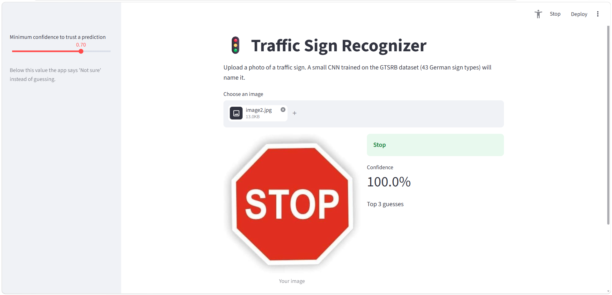

# Traffic Sign Recognizer 

A deep learning-based Traffic Sign Recognition system that classifies traffic signs into **43 different categories** using a custom Convolutional Neural Network (CNN). The model is trained on the German Traffic Sign Recognition Benchmark (GTSRB) dataset and predicts traffic sign categories from uploaded images.

Built using Python, PyTorch, CNN, and Streamlit. The project includes data preprocessing, image augmentation, model training, performance evaluation, and a web application for real-time image classification.

## App Screenshot



---

## Files in This Project

| File / Folder | Description |
|---|---|
| `traffic_sign_recognizer.ipynb` | Main Jupyter Notebook containing the complete deep learning pipeline, including data exploration, preprocessing, augmentation, CNN development, training, and evaluation. |
| `app.py` | Streamlit web application for uploading traffic sign images and viewing predictions with confidence scores. |
| `traffic_sign_cnn.pth` | Saved trained CNN model containing model weights, class names, and image preprocessing settings. |
| `Train/` | Training images from the GTSRB dataset. |
| `Test/` | Official test images from the GTSRB dataset. |
| `Meta/` | Traffic sign class metadata and reference images. |
| `my_photos/` | Folder for testing the trained model on personal traffic sign photographs. |
| `Train.csv` | Training image paths, class IDs, dimensions, and region-of-interest coordinates. |
| `Test.csv` | Official test image information and class labels. |
| `Meta.csv` | Metadata for the 43 traffic sign categories. |
| `cache_train_200_32.npz` | Cached preprocessed training images to avoid repeatedly loading and resizing images. |
| `UI.png` | Screenshot of the running Streamlit application. |
| `How to run.txt` | Quick instructions for launching the application. |
| `.ipynb_checkpoints/` | Automatically generated by Jupyter Notebook. Not required for the project. |

---

## Dataset

**German Traffic Sign Recognition Benchmark (GTSRB)**

The project uses the GTSRB dataset, which contains images of German traffic signs belonging to 43 different categories.

| Dataset | Total Images |
|---|---:|
| Training Dataset | 39,209 |
| Official Test Dataset | 12,630 |
| Traffic Sign Categories | 43 |

### Dataset Preparation

To keep model training lightweight and suitable for a CPU-based system:

- Selected 200 images per class from the training dataset.
- Created a balanced subset containing 8,600 images.
- Split the selected images into training and validation sets using an 80:20 ratio.
- Used 3,000 randomly selected images from the official test dataset for final evaluation.

| Data Split | Images | Percentage |
|---|---:|---:|
| Training | 6,880 | 80% |
| Validation | 1,720 | 20% |
| Testing | 3,000 | Separate official test subset |

---

## How It Works

The project follows a complete deep learning workflow, from image preprocessing to model deployment.

### 1. Data Loading and Exploration

- Loaded the GTSRB training, testing, and metadata CSV files using Pandas.
- Explored traffic sign categories and class distribution.
- Visualized sample images to understand the dataset.
- Examined image dimensions and identified class imbalance.

### 2. Data Preprocessing

- Extracted traffic sign regions using the provided bounding box coordinates.
- Removed unnecessary background around traffic signs.
- Resized images to `32 × 32` pixels.
- Converted images into NumPy arrays.
- Cached preprocessed images using NumPy to reduce repeated processing time.

### 3. Data Augmentation

Applied image augmentation using `torchvision.transforms` to improve model generalization.

Techniques used:
- Random Affine Transformations (up to 10° rotation).
- Random Translation.
- Random Scaling.
- Color Jitter (brightness and contrast adjustments).
- Image Normalization.

Horizontal flipping was intentionally avoided because flipping directional traffic signs can change their actual meaning.

### 4. CNN Model Development

Developed a custom Convolutional Neural Network using PyTorch with three convolution blocks.

**Model Architecture:**

| Layer | Configuration |
|---|---|
| Input | RGB Image (32 × 32 × 3) |
| Convolution Block 1 | Conv2D (3 → 32) + BatchNorm + ReLU + MaxPooling |
| Convolution Block 2 | Conv2D (32 → 64) + BatchNorm + ReLU + MaxPooling |
| Convolution Block 3 | Conv2D (64 → 128) + BatchNorm + ReLU + MaxPooling |
| Flatten | Converts feature maps into a 1D vector |
| Fully Connected Layer | 2048 → 256 |
| Activation | ReLU |
| Dropout | 0.4 |
| Output Layer | 256 → 43 Classes |

**Total Trainable Parameters:** 629,291

### 5. Model Training

Trained the CNN using the following configuration:

| Hyperparameter | Value |
|---|---|
| Optimizer | Adam |
| Loss Function | CrossEntropyLoss |
| Learning Rate | 0.001 |
| Batch Size | 64 |
| Epochs | 12 |
| Learning Rate Scheduler | StepLR |
| Scheduler Step Size | 5 |
| Scheduler Gamma | 0.5 |
| Random Seed | 42 |
| Hardware | CPU |

The model was trained for 12 epochs, and the best-performing model was saved based on validation accuracy.

### 6. Model Evaluation

Evaluated the trained model on 3,000 previously unseen images from the official GTSRB test dataset.

Evaluation techniques:
- Training and validation loss tracking.
- Training and validation accuracy monitoring.
- Classification report with precision, recall, and F1-score.
- Confusion matrix visualization.
- Error analysis to identify frequently confused traffic sign categories.

### 7. Real-World Image Testing

- Tested the trained model using personal traffic sign photographs.
- Generated the top 3 predictions with their confidence scores.
- Examined how the model performs on images outside the training samples.

### 8. Model Saving

Saved the trained model using PyTorch's `torch.save()`.

The saved checkpoint includes:
- Model state dictionary.
- Traffic sign class names.
- Image dimensions.
- Number of output classes.

---

## Results

The model achieved the following performance after 12 training epochs:

| Evaluation Metric | Result |
|---|---:|
| Best Validation Accuracy | 96.86% |
| Test Accuracy | 90.30% |
| Correct Test Predictions | 2,709 / 3,000 |
| Incorrect Test Predictions | 291 / 3,000 |
| Total Model Parameters | 629,291 |

**Note:** The evaluation was performed on a randomly selected subset of 3,000 images from the official test dataset, not the complete test dataset.

---

## Streamlit Web Application

Developed an interactive web application using Streamlit to make the trained model accessible through a simple user interface.

### Key Features

- **Image Upload:** Upload traffic sign images in JPG, JPEG, or PNG formats.
- **Automatic Classification:** Predicts the traffic sign category using the trained CNN model.
- **Confidence Score:** Displays the confidence percentage of the prediction.
- **Top 3 Predictions:** Shows the three most likely traffic sign categories with their confidence scores.
- **Confidence Threshold:** Allows users to adjust the minimum confidence required to trust a prediction.
- **Uncertain Prediction Handling:** Displays "Not sure" when the highest prediction confidence falls below the selected threshold.
- **Model Caching:** Uses Streamlit's `st.cache_resource` to load the trained model only once.

### Prediction Logic

The application uses Softmax to convert model outputs into class probabilities.

- If the highest confidence score is above the selected threshold, the predicted class is displayed.
- If the confidence score is below the threshold, the application displays "Not sure" along with the best guess.

The default confidence threshold is `0.70` (70%).

---

## How to Run

### 1. Install Dependencies

Open a terminal in the project folder and install the required libraries:

```bash
python -m pip install numpy pandas matplotlib seaborn scikit-learn pillow torch torchvision streamlit
```

### 2. Run the Streamlit Application

Make sure `traffic_sign_cnn.pth` and `app.py` are in the same project directory.

Open a terminal in that folder and execute:

```bash
python -m streamlit run app.py
```

### 3. Open the Application

Streamlit will automatically open the application in your browser.

If it does not open automatically, visit:

```text
http://localhost:8501
```

Upload a traffic sign image and view the predicted category, confidence score, and top 3 predictions.

---

## Tech Stack

- **Programming Language:** Python
- **Deep Learning Framework:** PyTorch
- **Model Architecture:** Convolutional Neural Network (CNN)
- **Libraries:** NumPy, Pandas, Matplotlib, Seaborn, Scikit-learn, Pillow
- **Image Processing:** PIL, Torchvision
- **Model Evaluation:** Accuracy, Precision, Recall, F1-Score, Confusion Matrix
- **Web Framework:** Streamlit
- **Environment:** Jupyter Notebook

## Skills Demonstrated

Python • Deep Learning • Convolutional Neural Networks (CNN) • PyTorch • Image Classification • Image Preprocessing • Data Augmentation • Feature Extraction • Model Training • Hyperparameter Tuning • Model Evaluation • Confusion Matrix • Streamlit • Model Deployment
